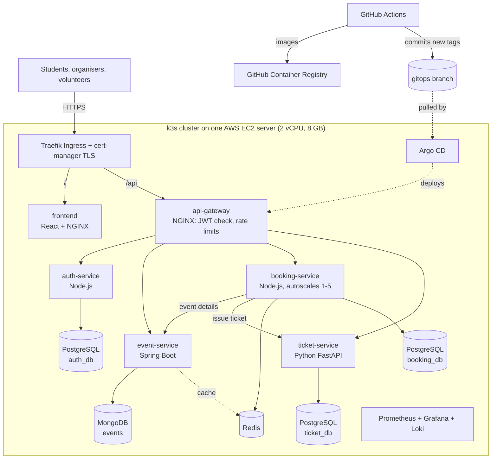

# CampusPass

Campus event ticketing that survives the registration rush.

When a popular fest event opens, hundreds of students hit "Book" in the same minute. CampusPass
sells exactly as many seats as exist, scales out automatically while the rush lasts, heals itself
when a pod dies, and gives every student a signed QR ticket that can be scanned once at the gate.

Built for **4CS505ME25 Cloud Native Applications and DevOps** (B.Tech CSE, Sem VII, 2026-27).

| | |
|---|---|
| Live site | `https://campuspass.duckdns.org` (after deployment) |
| Monitoring | `https://campuspass.duckdns.org/grafana` (read-only) |
| Pipeline | GitHub Actions tab of this repository |

## Architecture



| Service | Language | Data | Responsibility |
|---|---|---|---|
| frontend | React 19 + NGINX | none | Event list with live seat counters, booking, QR tickets, gate scanner, organiser page |
| api-gateway | NGINX | none | Single entry point; verifies JWTs via `auth_request`, rate-limits, adds request IDs |
| auth-service | Node.js 22 / Express | PostgreSQL `auth_db` | Sign-up, login, JWT issue and verification, roles via invite codes |
| event-service | Java 21 / Spring Boot 3.5 | MongoDB + Redis cache | Organisers publish events; students browse them |
| booking-service | Node.js 22 / Express | Redis + PostgreSQL `booking_db` | Atomic seat reservation (Redis Lua), saga-style compensation |
| ticket-service | Python 3.13 / FastAPI | PostgreSQL `ticket_db` | HMAC-signed QR tickets, one-time check-in |

### How a booking never oversells

1. The gateway checks the JWT and the per-user rate limit.
2. booking-service runs one **Lua script inside Redis**: check seats left, check the student has not
   booked, decrement, record. Redis runs it atomically, so 500 simultaneous requests cannot interleave.
3. The booking is written to PostgreSQL (the source of truth) and ticket-service issues a signed ticket.
4. If step 3 fails, booking-service **undoes** steps 2 and 3 (compensating actions), so seats are never lost.
5. If Redis loses its data, the counter is rebuilt from PostgreSQL before the next booking.

Tested: 500 concurrent students, 100 seats: exactly 100 confirmed, 400 "sold out", 0 errors.

## Run it

**Everything on your laptop (Docker Desktop):**

```powershell
copy .env.example .env
docker compose up --build
# open http://localhost:3000   (organiser invite code: ORG-2026, volunteer: VOL-2026)
```

**On Kubernetes locally (Minikube):** `.\scripts\local-k8s.ps1`

**On AWS with a public link:** follow [docs/DEPLOY.md](docs/DEPLOY.md).

## DevOps practices

| Area | What is used | Where |
|---|---|---|
| Microservices | 6 services, 3 languages, database per service, API gateway, service discovery by DNS | `services/` |
| Docker | Multi-stage builds, non-root users, read-only root filesystem, healthchecks, `.dockerignore`, multi-arch (amd64 + arm64), Spring Boot layered jars, Compose with healthcheck ordering | `services/*/Dockerfile`, `docker-compose.yml` |
| Infrastructure as Code | Terraform (AWS VPC, subnet, security group, EC2 with Elastic IP, budget alert) + cloud-init (k3s, cert-manager, monitoring, Argo CD) | `infra/terraform/` |
| Kubernetes | Kustomize base + overlays, Deployments, StatefulSets with PVCs, ConfigMaps, Secrets, probes, HPA, PDB, NetworkPolicies, Ingress with TLS, rolling updates | `k8s/` |
| CI/CD | GitHub Actions: scans, tests, image build, e2e test with load test, GitOps deploy, live verification | `.github/workflows/` |
| GitOps | Argo CD syncs `k8s/overlays/prod` from the `gitops` branch; CI never holds cluster credentials | `platform/argocd/` |
| DevSecOps | Gitleaks, Semgrep (SARIF to Security tab), Trivy config + image scans, SBOMs, npm/pip audit, Dependabot, OWASP ZAP, SHA-pinned actions, Pod Security Standards, NetworkPolicies, encrypted Secrets at rest | see below |
| Observability | Prometheus, Grafana "Registration Rush" dashboard, Loki logs via Alloy, alert rules, JSON logs with request IDs | `monitoring/` |
| Resilience | k6 rush test, chaos script, self-healing, graceful shutdown | `load-tests/`, `scripts/` |

### Security in the pipeline

Every push runs, before any image is built:

- **Gitleaks** over the full Git history (fails on any secret).
- **Semgrep** with the default, OWASP Top 10, Kubernetes and Dockerfile rule sets (fails on high severity; all findings go to the Security tab).
- **Trivy** misconfiguration scan of Dockerfiles, Kubernetes manifests, Compose and Terraform (fails on HIGH/CRITICAL). Reviewed false positives are listed with reasons in `trivyignore.yaml`.
- **Hadolint**, **kubeconform** and **Helm template** checks.
- **npm audit** and **pip-audit** for vulnerable dependencies.

Then each image is scanned by Trivy (fails on fixable CRITICAL CVEs) and gets a CycloneDX SBOM.
After deployment an **OWASP ZAP** baseline scan tests the live site.

All third-party actions are pinned to commit SHAs, and Trivy is pinned to v0.69.3. In March 2026
attackers rewrote most `aquasecurity/trivy-action` tags and published malicious Trivy releases
(v0.69.4 to v0.69.6) to steal CI secrets; pinning by SHA makes this pipeline immune to retagging.

## Repository layout

```text
services/            six microservices, each with its own Dockerfile and tests
docker-compose.yml   the whole system on one machine
k8s/                 Kustomize base + local (Minikube) and prod (AWS) overlays
infra/terraform/     AWS network, EC2 server, budget alert and cloud-init
platform/argocd/     Argo CD applications (GitOps)
monitoring/          Helm values, Grafana dashboard, alert rules
load-tests/          k6 registration-rush test
scripts/             smoke test, PowerShell helpers (bootstrap, rush, chaos, Minikube)
.github/             CI/CD and infrastructure workflows, Dependabot
docs/                deployment guide and demo script
```

## Demo

See [docs/DEMO.md](docs/DEMO.md) for the 10-minute demo, step by step.
